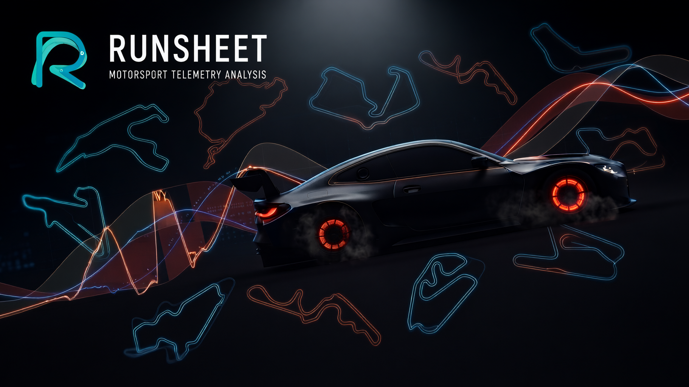

<p align="center">
  
</p>

<p align="center">
  <strong>Motorsport Telemetry Analysis</strong>
</p>

<p align="center">
  <a href="LICENSE"></a>
  <a href="LICENSE"></a>
  
  
</p>

<p align="center">
  <strong><a href="README.md">English</a> · <a href="README.ru.md">Русский</a> · <a href="docs/CONCEPT.md">Concept</a> · <a href="docs/CONCEPT.ru.md">Концепция</a></strong>
</p>

<p align="center">
  
</p>

**Runsheet** is a session sheet for the **Assetto Corsa Competizione** simulator. The app reads telemetry from the game’s shared memory and keeps a chronological outing log: laps, sector times, fuel use, and lap validity are recorded automatically, with no separate start-recording command. Closed sessions stay in the journal for later review and telemetry comparison.

## Features

- [x] Automatic capture of laps, sector times, fuel use, and lap validity
- [x] Catalog of 25 ACC tracks with filters, personal bests, and attempt counts
- [x] Outing journal grouped by day and session type
- [x] Live outing card: air and asphalt temperature, tyre pressure, vector track map
- [x] Flat track scene with asphalt-surface boundaries
- [x] Trajectory and racing-line comparison on the map
- [x] Telemetry channel charts [speed | throttle | brake | gear | steer]
- [x] Two-lap telemetry comparison: charts, racing-line overlay, and cockpit controls; automatic divergence detection
- [x] Import and export of the outing journal
- [x] UI theming via CSS custom properties
- [x] UI localization with an extensible language set

---

## Roadmap

### Next
- [ ] Session export to CSV / MoTeC
- [ ] Interactive UI onboarding tour

### Simulators
- [ ] Le Mans Ultimate — telemetry via shared memory ([kerb](https://crates.io/crates/kerb)), automatic session capture, car and track catalogs
- [ ] RaceRoom — telemetry via shared memory (`$R3E` / r3e-api, [simetry](https://crates.io/crates/simetry)), automatic session capture, car and track catalogs
- [ ] iRacing — telemetry via SDK / shared memory ([pitwall](https://crates.io/crates/pitwall)), automatic session capture, car and track catalogs

---

## Demo

https://github.com/user-attachments/assets/0669f286-4e5b-4b5b-856e-6f346069dacf

---

## Screenshots

### Track catalog


### Live card

Spa · lap table with S1/S2/S3, fuel, delta, and mini-map.

| Slate | Light |
|:----:|:-----:|
|  |  |

### Telemetry comparison

Monza · BMW M4 · two-lap overlay — throttle, brake, steer, speed, racing line, and divergence zones.

| Dark | Light |
|:----:|:-----:|
|  |  |

---

## Install & build

**Needs**

- [Bun](https://bun.sh/) — local install and `dev` / `test`
- [Rust](https://www.rust-lang.org/tools/install) (stable)
- [Tauri 2 prerequisites](https://v2.tauri.app/start/prerequisites/)
- **Windows** for live ACC shared-memory reading (unavailable on macOS/Linux)

> Release CI on Windows uses **npm** (Bun often hangs on `windows-latest`). Day-to-day development stays on Bun.

```bash
# Dependencies
bun install

# UI only (Vite; sample data in dev)
bun run dev

# Full app
bun run tauri dev

# Release build
bun run tauri build
```

```bash
# Checks
bun run test
cargo check --manifest-path src-tauri/Cargo.toml
cargo test --manifest-path src-tauri/Cargo.toml
```


---

## Contributing

Contributions are welcome. For larger changes, please open an issue first to discuss what you would like to change.

1. Fork the repository and create your branch from `main`.
2. Make your changes and ensure checks pass:

```bash
bun run test
cargo test --manifest-path src-tauri/Cargo.toml
```

3. Open a pull request with a clear description of the change.

---

## License

Copyright (C) 2026 indrane

Licensed under the [GNU General Public License v3.0 or later](LICENSE).
