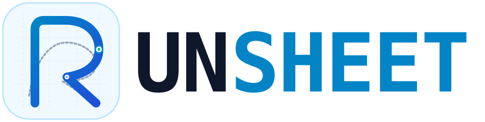
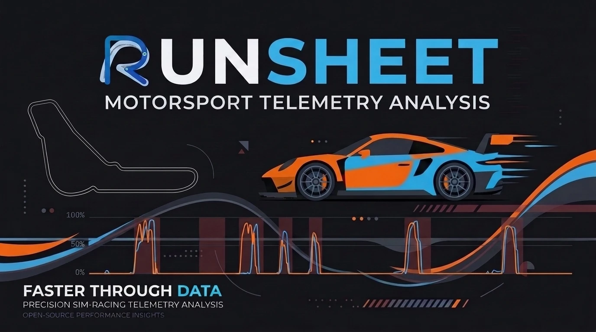
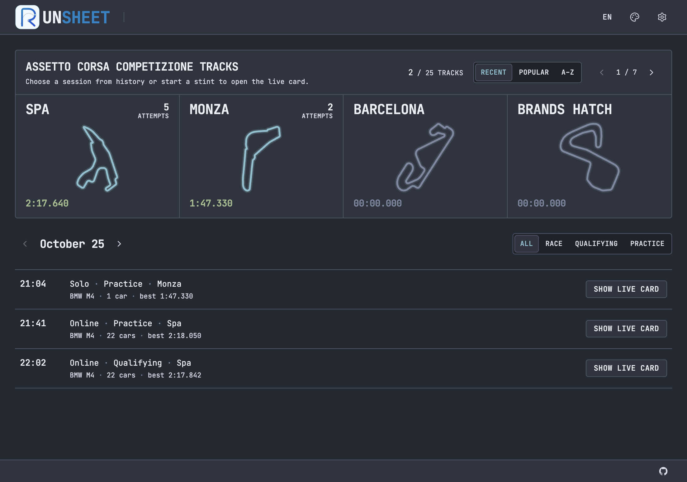
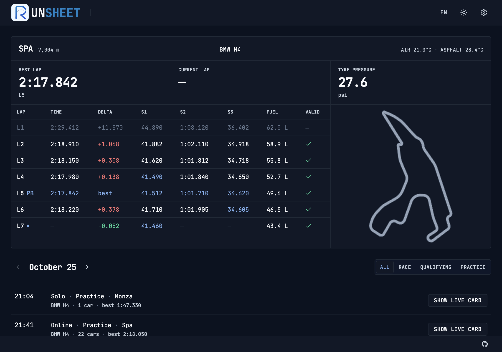
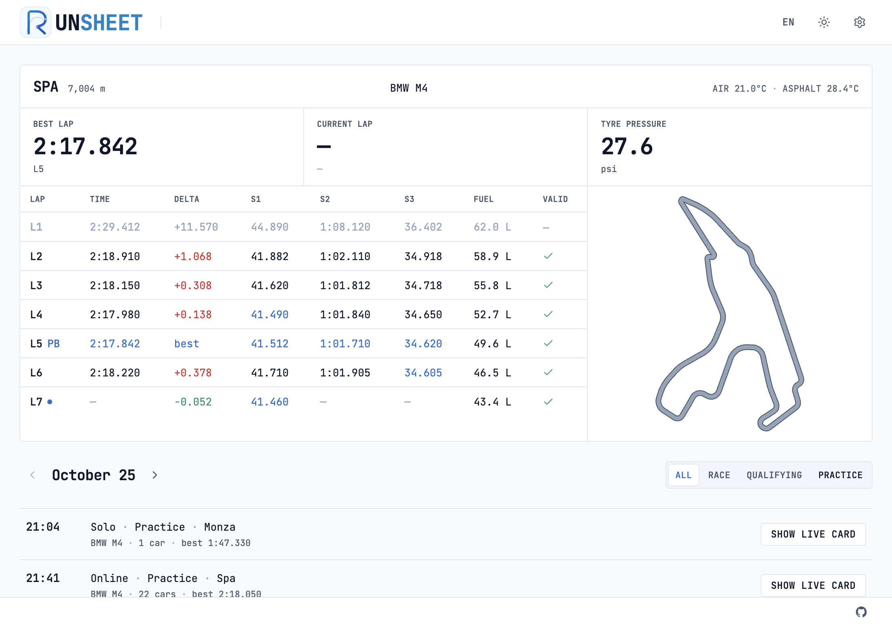
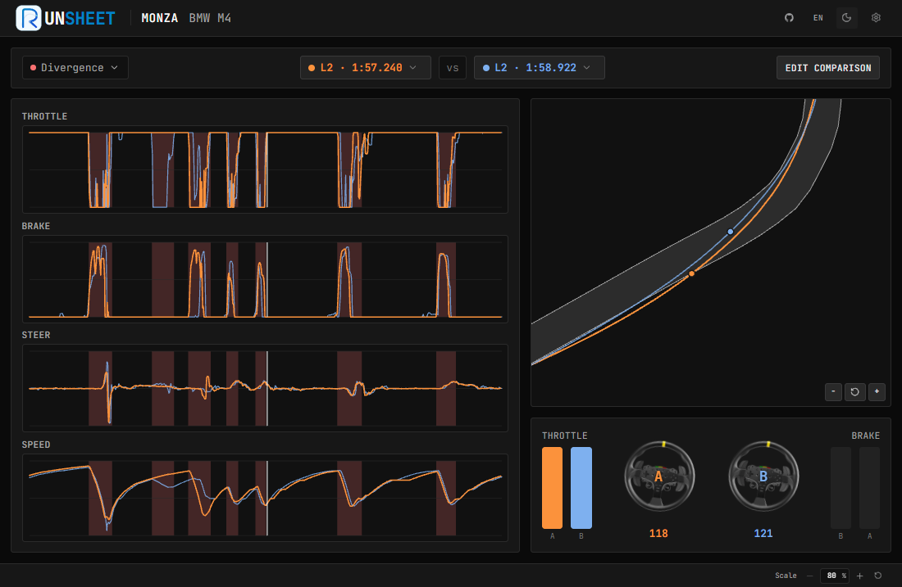
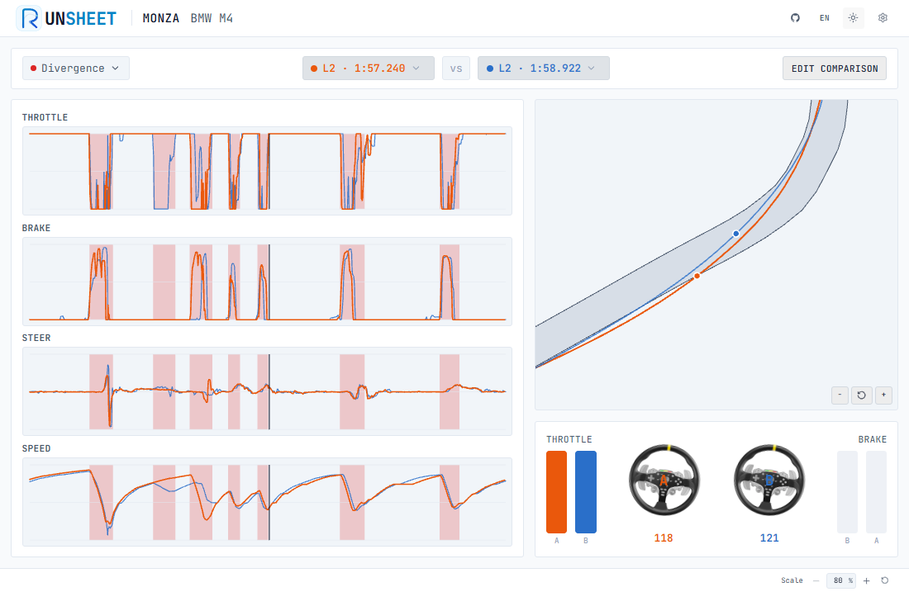

<p align="center">
  
</p>

<p align="center">
  <strong>Motorsport Telemetry Analysis</strong>
</p>

<p align="center">
  <a href="LICENSE"></a>
  <a href="LICENSE"></a>
  
  
</p>

<p align="center">
  <strong><a href="README.md">English</a> · <a href="README.ru.md">Русский</a> · <a href="docs/CONCEPT.md">Concept</a> · <a href="docs/CONCEPT.ru.md">Концепция</a></strong>
</p>

<p align="center">
  
</p>

**Runsheet** is a lightweight, local-first session sheet and pit-wall tool for the **Assetto Corsa Competizione** simulator. Built with Rust and Tauri 2, it runs with near-zero CPU overhead, capturing telemetry from shared memory without affecting simulator framerates. Laps, sector times, fuel use, and validity are logged automatically for later review and telemetry comparison.

## Features

- [x] **Zero-config session logging** — automatic capture of laps, sector times S1/S2/S3, fuel consumption, and lap validity via ACC shared memory
- [x] **Live pit-wall card** — real-time track and air conditions, tyre pressures, live sector deltas, and interactive vector track map
- [x] **Two-lap telemetry comparison** — multi-channel charts for speed, throttle, brake, steering angle, and gear with synchronized distance scrubbing
- [x] **Automated divergence detection** — smart algorithm highlighting key braking, throttle, and speed loss zones between laps
- [x] **2D trajectory & racing-line overlay** — GPU-accelerated PixiJS track surface view with asphalt boundaries, apex zoom, and car follow mode
- [x] **Interactive cockpit HUD** — pedal stack and animated steering wheel cluster showing instant driver inputs at cursor position
- [x] **Track & session catalog** — all 25 ACC tracks with personal bests, historical session journal grouped by day, and export/import
- [x] **Lightweight & local-first** — tiny binary (~15 MB), minimal RAM usage (<60 MB), zero game FPS impact, multi-theme support, and full localization (English, Russian)

---

## Roadmap

### Next
- [ ] Session export to CSV / MoTeC
- [ ] Interactive UI onboarding tour
- [ ] AI Driver Coach — automated telemetry feedback and driving advice via user-provided OpenAI-compatible API keys analyzing divergence zones

### Simulators
- [ ] Le Mans Ultimate — telemetry via shared memory ([kerb](https://crates.io/crates/kerb)), automatic session capture, car and track catalogs
- [ ] RaceRoom — telemetry via shared memory (`$R3E` / r3e-api, [simetry](https://crates.io/crates/simetry)), automatic session capture, car and track catalogs
- [ ] iRacing — telemetry via SDK / shared memory ([pitwall](https://crates.io/crates/pitwall)), automatic session capture, car and track catalogs

---

## Demo

https://github.com/user-attachments/assets/0669f286-4e5b-4b5b-856e-6f346069dacf

---

## Screenshots

### Track catalog



### Live card

Spa · lap table with S1/S2/S3, fuel, delta, and mini-map.

| Slate | Light |
|:----:|:-----:|
|  |  |

### Telemetry comparison

Monza · BMW M4 · two-lap overlay — throttle, brake, steer, speed, racing line, and divergence zones.

| Dark | Light |
|:----:|:-----:|
|  |  |

---

## Install & build

**Needs**

- [Bun](https://bun.sh/) — local install and `dev` / `test`
- [Rust](https://www.rust-lang.org/tools/install) (stable)
- [Tauri 2 prerequisites](https://v2.tauri.app/start/prerequisites/)
- **Windows** for live ACC shared-memory reading (unavailable on macOS/Linux)

> Release CI on Windows uses **npm** (Bun often hangs on `windows-latest`). Day-to-day development stays on Bun.

```bash
# Dependencies
bun install

# UI only (Vite; sample data in dev)
bun run dev

# Full app
bun run tauri dev

# Release build
bun run tauri build
```

```bash
# Checks
bun run test
cargo check --manifest-path src-tauri/Cargo.toml
cargo test --manifest-path src-tauri/Cargo.toml
```


---

## Contributing

Contributions are welcome. For larger changes, please open an issue first to discuss what you would like to change.

1. Fork the repository and create your branch from `main`.
2. Make your changes and ensure checks pass:

```bash
bun run test
cargo test --manifest-path src-tauri/Cargo.toml
```

3. Open a pull request with a clear description of the change.

---

## License

Copyright (C) 2026 indrane

Licensed under the [GNU General Public License v3.0 or later](LICENSE).
