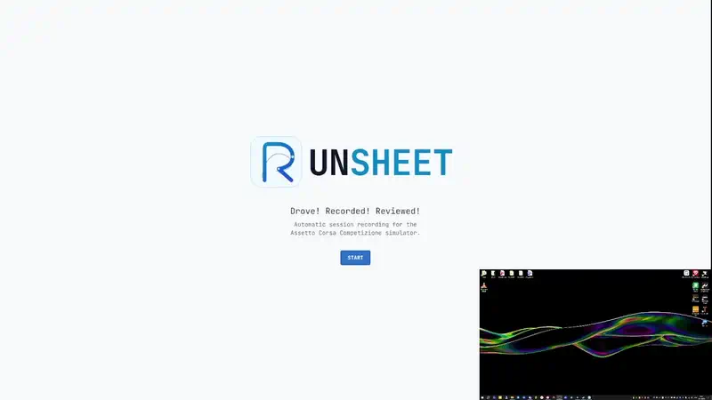
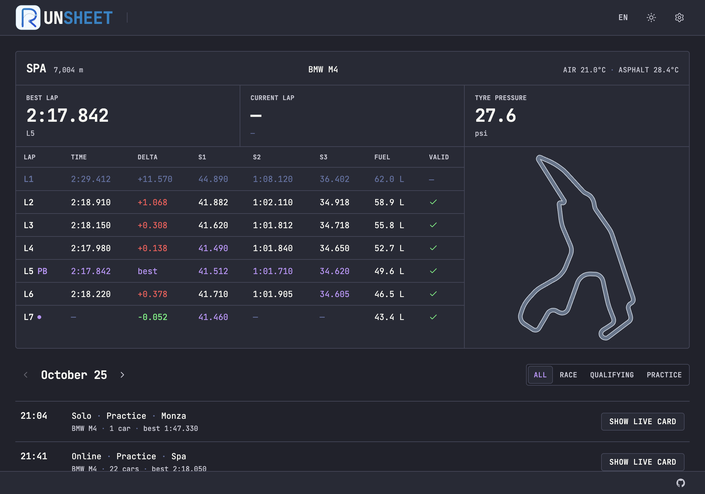
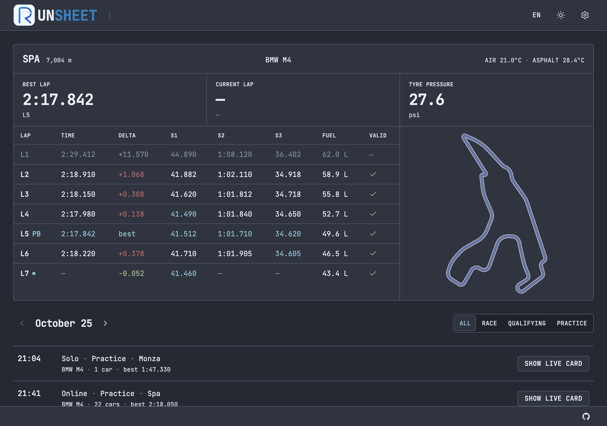

<p align="center">
  
</p>

<p align="center">
  <strong><a href="README.md">English</a> · <a href="README.ru.md">Русский</a> · <a href="docs/CONCEPT.md">Concept</a> · <a href="docs/CONCEPT.ru.md">Концепция</a></strong>
</p>

<p align="center">
  <a href="LICENSE"></a>
  <a href="LICENSE"></a>
  
  
</p>

Лист заездов для **Assetto Corsa Competizione**. Открыл программу, поехал — круги, секторы (S1–S3), топливо и зачёт пишутся сами. Кнопки «начать запись» нет.

> Идея продукта и модель заезда: **[docs/CONCEPT.ru.md](docs/CONCEPT.ru.md)**

## Демо

<!--
  Если ролик загружен через GitHub Issues или Release, замените ссылку
  на CDN-адрес: https://github.com/user-attachments/assets/...
-->

[](https://github.com/indraine/Runsheet/blob/main/docs/demo.mp4)

> 💡 [Смотреть MP4 на GitHub](https://github.com/indraine/Runsheet/blob/main/docs/demo.mp4)

---

## Скриншоты

### Каталог трасс


### Живая карточка

Спа · таблица кругов с S1/S2/S3, топливом, дельтой и мини-картой.

| Dark | Light |
|:----:|:-----:|
|  |  |

| Dracula | Nord |
|:-------:|:----:|
|  |  |

---

## Что умеет сейчас (v1.0.0)

- [x] Сам пишет круги, секторы (S1 / S2 / S3), расход топлива и зачёт круга
- [x] Каталог 25 трасс ACC — фильтры «недавние», «популярные», A–Z; личные рекорды и число попыток
- [x] Журнал заездов по дням и типам (тренировка, квалификация, гонка / одиночная, онлайн)
- [x] Живая карточка: воздух и асфальт, давление в шинах (psi), векторная карта трассы
- [x] 11 тем оформления (Dark, Light, Dracula, Nord, Monokai, Gruvbox, Mocha, Solarized и др.)
- [x] Два языка интерфейса (EN / RU)

---

## Планы

### v1.1.0 — Разбор и траектории
- [ ] Плоская сцена трассы с границами полотна
- [ ] Траектории и сравнение гоночных линий на карте
- [ ] Графики (скорость, газ, тормоз, передача, руль)
- [ ] Выгрузка сессии в CSV / MoTeC

### v2.0.0 — iRacing
- [ ] Чтение телеметрии через iRacing SDK / общую память
- [ ] Автоматическая фиксация сессий и заездов в iRacing
- [ ] Каталоги машин и трасс iRacing

### v3.0.0 — Automobilista 2
- [ ] Чтение общей памяти AMS2
- [ ] Учёт сессий и приведение телеметрии AMS2 к общим типам

---

## Установка и сборка

**Что нужно**

- [Bun](https://bun.sh/)
- [Rust](https://www.rust-lang.org/tools/install) (stable)
- [Предварительные требования Tauri 2](https://v2.tauri.app/start/prerequisites/)
- **Windows** для живого чтения общей памяти ACC (на macOS/Linux чтение недоступно)

```bash
# Зависимости
bun install

# Только интерфейс (Vite; в разработке — тестовые данные)
bun run dev

# Полное приложение
bun run tauri dev

# Релизная сборка
bun run tauri build
```

```bash
# Проверки
bun run test
cargo check --manifest-path src-tauri/Cargo.toml
cargo test --manifest-path src-tauri/Cargo.toml
```

---

## Стек

| Слой | Чем собран |
|------|------------|
| Оболочка | Tauri 2 |
| Серверная часть | Rust; сейчас — чтение общей памяти ACC (`acc_shared_memory_rs`) |
| Клиент | SolidJS, TypeScript, Vite 8 |
| Интерфейс | Tailwind CSS 4, Ark UI, Lucide |
| Карта | PixiJS |
| Хранение | IndexedDB (`idb`) |
| Языки | `@solid-primitives/i18n` (EN / RU) |

---

## Архитектура

Данные из симулятора проходят одну границу приёма: сырой буфер общей памяти не покидает `src-tauri/src/ingress/`, а сразу приводится к доменным типам. Дальше — конвейер чтения, сервисы заездов и кругов, интерфейс — без привязки к конкретной игре.

В v1.0.0 подключён только ACC. Через ту же границу позже добавятся iRacing (v2.0.0) и Automobilista 2 (v3.0.0), без смены логики сессий.

| Путь | Роль |
|------|------|
| `src-tauri/src/ingress/` | Чтение конкретной игры и однократная нормализация на границе |
| `src-tauri/src/domain/` | Чистые типы и состояния машины (`CarState`), без внешних SDK |
| `src-tauri/src/pipeline/` · `services/` | Частый опрос, сбор заездов и кругов |
| `src-tauri/src/ipc/` + `src/` | Тонкий мост и интерфейс листа сессии |

Правила и раскладка: [AGENTS.md](AGENTS.md).

---

## Участие

1. Сделайте копию репозитория и ветку под задачу.
2. Обработчики держите короткими; логику заезда — в сервисах и `domain`.
3. Перед PR прогоните `bun run test` и тесты на Rust.
4. Лучше небольшие PR с коротким «зачем» в описании.

Правила и раскладка: [AGENTS.md](AGENTS.md) · идея продукта: [docs/CONCEPT.ru.md](docs/CONCEPT.ru.md).

---

## Лицензия

Copyright (C) 2026 indrane

Лицензия: [GNU General Public License v3.0 or later](LICENSE).
